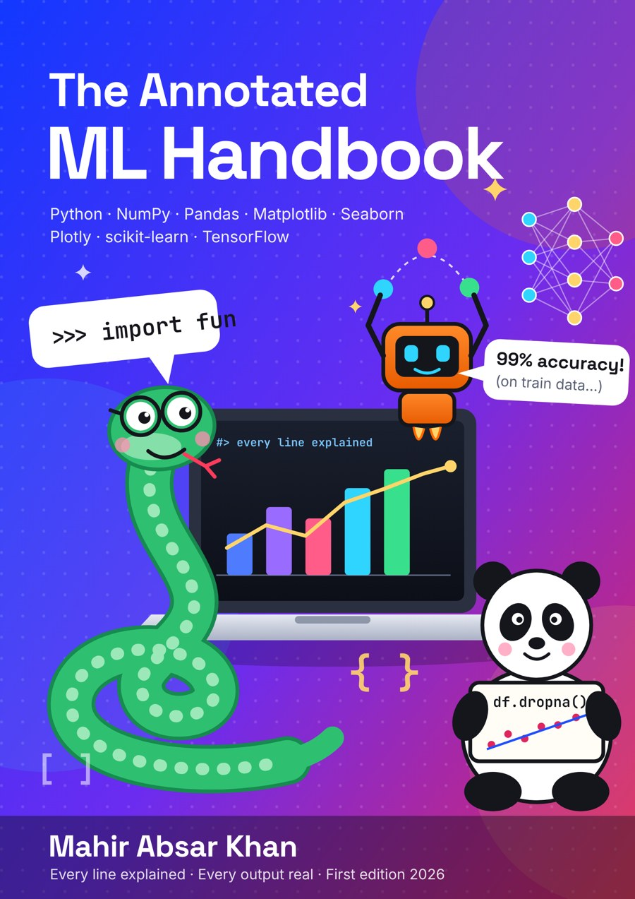

<div align="center">



# The Annotated ML Handbook: companion code

**Python → NumPy → pandas → Matplotlib · Seaborn · Plotly → scikit-learn → TensorFlow & Keras**
*From your first line of code to machine learning you can publish.*

[](https://github.com/Mahir-606/annotated-ml-handbook/actions/workflows/run-notebooks.yml)


[](LICENSE)

</div>

This repository holds **every code example** from *The Annotated ML Handbook* by **Mahir Absar Khan**: one runnable notebook (and one plain Python script) per chapter, all **34 chapters' exercises**, **worked solutions**, and every **figure** the book's code produces.

The book explains each example line by line, defines every term, and walks through what the output means. This repository gives you the code itself, so you can run it, change it and reuse it in your own projects and research.

> 📘 **Get the book:** *link coming soon*

## What's inside

| | |
|---|---|
| 📓 **[notebooks/](notebooks)** | 34 Jupyter notebooks, one per chapter, in book order, stored **with their outputs** so you can read them right here on GitHub |
| 🐍 **[scripts/](scripts)** | The same code as `.py` files with `# %%` cells (run cell by cell in VS Code, PyCharm or Spyder) |
| ✍️ **[exercises/](exercises)** | Every *Try it yourself* exercise, chapter by chapter |
| ✅ **[solutions/](solutions)** | Worked solutions to every exercise, as notebooks and scripts |
| 📊 **[data/](data)** | `insurance.csv`, the practice dataset built in Chapter 11 and reused in later chapters (copied in automatically by each notebook's setup cell) |
| 🖼️ **[figures/](figures)** | All 121 figures the book's code generates, as PNGs, by chapter |
| 🛠️ **[tools/](tools)** | `run_all.py` runs every notebook and checks that it still works |

**Numbers:** 439 executable examples, including **48 deliberate error examples** (cells tagged `raises-exception`) that show the exact message you will meet, so you can recognise it when it happens in your own code.

## Quick start

### Option 1: Google Colab (nothing to install)
Click a **Open in Colab** badge in the chapter table below. Run the first cell (*repository setup*), then run the cells from top to bottom.

### Option 2: On your computer

```bash
git clone https://github.com/Mahir-606/annotated-ml-handbook.git
cd annotated-ml-handbook
python -m venv .venv
source .venv/bin/activate          # Windows: .venv\Scripts\activate
pip install -r requirements.txt
jupyter lab                        # then open notebooks/part-1-python/01-python-basics.ipynb
```

With conda instead: `conda env create -f environment.yml && conda activate annotated-ml`.

Run a chapter as a plain script: `python scripts/part-5-scikit-learn/21-sklearn-regression.py`

Check that every notebook runs on your machine: `python tools/run_all.py`

> **Tip:** each notebook starts with a small setup cell. It applies the book's figure style and sends any files the examples create (CSV files, saved models, exported figures) into an `outputs/` folder, which git ignores.

## Chapters

### 

| # | Chapter | Notebook | Script | Colab |
|---:|---|---|---|:---:|
| 1 | Values, variables and types | [notebook](notebooks/part-1-python/01-python-basics.ipynb) | [script](scripts/part-1-python/01-python-basics.py) | [](https://colab.research.google.com/github/Mahir-606/annotated-ml-handbook/blob/main/notebooks/part-1-python/01-python-basics.ipynb) |
| 2 | Data structures: lists, tuples, dictionaries, sets | [notebook](notebooks/part-1-python/02-python-collections.ipynb) | [script](scripts/part-1-python/02-python-collections.py) | [](https://colab.research.google.com/github/Mahir-606/annotated-ml-handbook/blob/main/notebooks/part-1-python/02-python-collections.ipynb) |
| 3 | Control flow: decisions and loops | [notebook](notebooks/part-1-python/03-python-control.ipynb) | [script](scripts/part-1-python/03-python-control.py) | [](https://colab.research.google.com/github/Mahir-606/annotated-ml-handbook/blob/main/notebooks/part-1-python/03-python-control.ipynb) |
| 4 | Functions: reusable, testable logic | [notebook](notebooks/part-1-python/04-python-functions.ipynb) | [script](scripts/part-1-python/04-python-functions.py) | [](https://colab.research.google.com/github/Mahir-606/annotated-ml-handbook/blob/main/notebooks/part-1-python/04-python-functions.ipynb) |
| 5 | Classes and objects | [notebook](notebooks/part-1-python/05-python-oop.ipynb) | [script](scripts/part-1-python/05-python-oop.py) | [](https://colab.research.google.com/github/Mahir-606/annotated-ml-handbook/blob/main/notebooks/part-1-python/05-python-oop.ipynb) |
| 6 | Errors, files and modules | [notebook](notebooks/part-1-python/06-python-errors-files.ipynb) | [script](scripts/part-1-python/06-python-errors-files.py) | [](https://colab.research.google.com/github/Mahir-606/annotated-ml-handbook/blob/main/notebooks/part-1-python/06-python-errors-files.ipynb) |
| 7 | The Pythonic toolkit | [notebook](notebooks/part-1-python/07-python-toolkit.ipynb) | [script](scripts/part-1-python/07-python-toolkit.py) | [](https://colab.research.google.com/github/Mahir-606/annotated-ml-handbook/blob/main/notebooks/part-1-python/07-python-toolkit.ipynb) |

### 

| # | Chapter | Notebook | Script | Colab |
|---:|---|---|---|:---:|
| 8 | NumPy arrays: shape, dtype and indexing | [notebook](notebooks/part-2-numpy/08-numpy-arrays.ipynb) | [script](scripts/part-2-numpy/08-numpy-arrays.py) | [](https://colab.research.google.com/github/Mahir-606/annotated-ml-handbook/blob/main/notebooks/part-2-numpy/08-numpy-arrays.ipynb) |
| 9 | Computing with NumPy: vectorization, broadcasting, statistics, linear algebra | [notebook](notebooks/part-2-numpy/09-numpy-compute.ipynb) | [script](scripts/part-2-numpy/09-numpy-compute.py) | [](https://colab.research.google.com/github/Mahir-606/annotated-ml-handbook/blob/main/notebooks/part-2-numpy/09-numpy-compute.ipynb) |
| 10 | Machine learning from scratch with NumPy | [notebook](notebooks/part-2-numpy/10-numpy-ml-scratch.ipynb) | [script](scripts/part-2-numpy/10-numpy-ml-scratch.py) | [](https://colab.research.google.com/github/Mahir-606/annotated-ml-handbook/blob/main/notebooks/part-2-numpy/10-numpy-ml-scratch.ipynb) |

### 

| # | Chapter | Notebook | Script | Colab |
|---:|---|---|---|:---:|
| 11 | pandas foundations: Series, DataFrames and selection | [notebook](notebooks/part-3-pandas/11-pandas-basics.ipynb) | [script](scripts/part-3-pandas/11-pandas-basics.py) | [](https://colab.research.google.com/github/Mahir-606/annotated-ml-handbook/blob/main/notebooks/part-3-pandas/11-pandas-basics.ipynb) |
| 12 | Cleaning data with pandas | [notebook](notebooks/part-3-pandas/12-pandas-cleaning.ipynb) | [script](scripts/part-3-pandas/12-pandas-cleaning.py) | [](https://colab.research.google.com/github/Mahir-606/annotated-ml-handbook/blob/main/notebooks/part-3-pandas/12-pandas-cleaning.ipynb) |
| 13 | Grouping, reshaping, joining and time series | [notebook](notebooks/part-3-pandas/13-pandas-transform.ipynb) | [script](scripts/part-3-pandas/13-pandas-transform.py) | [](https://colab.research.google.com/github/Mahir-606/annotated-ml-handbook/blob/main/notebooks/part-3-pandas/13-pandas-transform.ipynb) |

### 

| # | Chapter | Notebook | Script | Colab |
|---:|---|---|---|:---:|
| 14 | Matplotlib and Seaborn: from first plot to publication figure | [notebook](notebooks/part-4-visualization/14-viz-matplotlib.ipynb) | [script](scripts/part-4-visualization/14-viz-matplotlib.py) | [](https://colab.research.google.com/github/Mahir-606/annotated-ml-handbook/blob/main/notebooks/part-4-visualization/14-viz-matplotlib.ipynb) |
| 15 | The Matplotlib chart gallery | [notebook](notebooks/part-4-visualization/15-viz-mpl-gallery.ipynb) | [script](scripts/part-4-visualization/15-viz-mpl-gallery.py) | [](https://colab.research.google.com/github/Mahir-606/annotated-ml-handbook/blob/main/notebooks/part-4-visualization/15-viz-mpl-gallery.ipynb) |
| 16 | The Seaborn chart gallery | [notebook](notebooks/part-4-visualization/16-viz-seaborn-gallery.ipynb) | [script](scripts/part-4-visualization/16-viz-seaborn-gallery.py) | [](https://colab.research.google.com/github/Mahir-606/annotated-ml-handbook/blob/main/notebooks/part-4-visualization/16-viz-seaborn-gallery.ipynb) |
| 17 | Interactive charts with Plotly | [notebook](notebooks/part-4-visualization/17-viz-plotly.ipynb) | [script](scripts/part-4-visualization/17-viz-plotly.py) | [](https://colab.research.google.com/github/Mahir-606/annotated-ml-handbook/blob/main/notebooks/part-4-visualization/17-viz-plotly.ipynb) |
| 18 | Figures for papers, theses and assignments | [notebook](notebooks/part-4-visualization/18-viz-export.ipynb) | [script](scripts/part-4-visualization/18-viz-export.py) | [](https://colab.research.google.com/github/Mahir-606/annotated-ml-handbook/blob/main/notebooks/part-4-visualization/18-viz-export.ipynb) |

### 

| # | Chapter | Notebook | Script | Colab |
|---:|---|---|---|:---:|
| 19 | Machine-learning concepts and the scikit-learn API | [notebook](notebooks/part-5-scikit-learn/19-sklearn-concepts.ipynb) | [script](scripts/part-5-scikit-learn/19-sklearn-concepts.py) | [](https://colab.research.google.com/github/Mahir-606/annotated-ml-handbook/blob/main/notebooks/part-5-scikit-learn/19-sklearn-concepts.ipynb) |
| 20 | Preprocessing, feature engineering and pipelines | [notebook](notebooks/part-5-scikit-learn/20-sklearn-preprocessing.ipynb) | [script](scripts/part-5-scikit-learn/20-sklearn-preprocessing.py) | [](https://colab.research.google.com/github/Mahir-606/annotated-ml-handbook/blob/main/notebooks/part-5-scikit-learn/20-sklearn-preprocessing.ipynb) |
| 21 | Regression: predicting numbers | [notebook](notebooks/part-5-scikit-learn/21-sklearn-regression.ipynb) | [script](scripts/part-5-scikit-learn/21-sklearn-regression.py) | [](https://colab.research.google.com/github/Mahir-606/annotated-ml-handbook/blob/main/notebooks/part-5-scikit-learn/21-sklearn-regression.ipynb) |
| 22 | Classification: predicting categories | [notebook](notebooks/part-5-scikit-learn/22-sklearn-classification.ipynb) | [script](scripts/part-5-scikit-learn/22-sklearn-classification.py) | [](https://colab.research.google.com/github/Mahir-606/annotated-ml-handbook/blob/main/notebooks/part-5-scikit-learn/22-sklearn-classification.ipynb) |
| 23 | Model selection: cross-validation and hyperparameter tuning | [notebook](notebooks/part-5-scikit-learn/23-sklearn-model-selection.ipynb) | [script](scripts/part-5-scikit-learn/23-sklearn-model-selection.py) | [](https://colab.research.google.com/github/Mahir-606/annotated-ml-handbook/blob/main/notebooks/part-5-scikit-learn/23-sklearn-model-selection.ipynb) |
| 24 | Unsupervised learning: clustering and dimensionality reduction | [notebook](notebooks/part-5-scikit-learn/24-sklearn-unsupervised.ipynb) | [script](scripts/part-5-scikit-learn/24-sklearn-unsupervised.py) | [](https://colab.research.google.com/github/Mahir-606/annotated-ml-handbook/blob/main/notebooks/part-5-scikit-learn/24-sklearn-unsupervised.ipynb) |
| 25 | Interpreting, explaining and saving models | [notebook](notebooks/part-5-scikit-learn/25-sklearn-interpret.ipynb) | [script](scripts/part-5-scikit-learn/25-sklearn-interpret.py) | [](https://colab.research.google.com/github/Mahir-606/annotated-ml-handbook/blob/main/notebooks/part-5-scikit-learn/25-sklearn-interpret.ipynb) |

### 

| # | Chapter | Notebook | Script | Colab |
|---:|---|---|---|:---:|
| 26 | TensorFlow fundamentals: tensors, gradients and data pipelines | [notebook](notebooks/part-6-tensorflow-keras/26-tf-basics.ipynb) | [script](scripts/part-6-tensorflow-keras/26-tf-basics.py) | [](https://colab.research.google.com/github/Mahir-606/annotated-ml-handbook/blob/main/notebooks/part-6-tensorflow-keras/26-tf-basics.ipynb) |
| 27 | Neural networks with Keras | [notebook](notebooks/part-6-tensorflow-keras/27-keras-mlp.ipynb) | [script](scripts/part-6-tensorflow-keras/27-keras-mlp.py) | [](https://colab.research.google.com/github/Mahir-606/annotated-ml-handbook/blob/main/notebooks/part-6-tensorflow-keras/27-keras-mlp.ipynb) |
| 28 | Deep learning architectures: CNNs, sequence models and custom training | [notebook](notebooks/part-6-tensorflow-keras/28-keras-advanced.ipynb) | [script](scripts/part-6-tensorflow-keras/28-keras-advanced.py) | [](https://colab.research.google.com/github/Mahir-606/annotated-ml-handbook/blob/main/notebooks/part-6-tensorflow-keras/28-keras-advanced.ipynb) |

### 

| # | Chapter | Notebook | Script | Colab |
|---:|---|---|---|:---:|
| 29 | The ML research protocol: a complete worked study | [notebook](notebooks/part-7-ml-for-research/29-research-protocol.ipynb) | [script](scripts/part-7-ml-for-research/29-research-protocol.py) | [](https://colab.research.google.com/github/Mahir-606/annotated-ml-handbook/blob/main/notebooks/part-7-ml-for-research/29-research-protocol.ipynb) |
| 30 | Choosing models and metrics, and comparing them rigorously | [notebook](notebooks/part-7-ml-for-research/30-research-choosing.ipynb) | [script](scripts/part-7-ml-for-research/30-research-choosing.py) | [](https://colab.research.google.com/github/Mahir-606/annotated-ml-handbook/blob/main/notebooks/part-7-ml-for-research/30-research-choosing.ipynb) |
| 31 | Reproducibility, leakage checklists and writing it up | [notebook](notebooks/part-7-ml-for-research/31-research-reporting.ipynb) | [script](scripts/part-7-ml-for-research/31-research-reporting.py) | [](https://colab.research.google.com/github/Mahir-606/annotated-ml-handbook/blob/main/notebooks/part-7-ml-for-research/31-research-reporting.ipynb) |

### 

| # | Chapter | Notebook | Script | Colab |
|---:|---|---|---|:---:|
| 32 | How to debug: reading tracebacks and a systematic method | [notebook](notebooks/part-8-debugging/32-debug-strategy.ipynb) | [script](scripts/part-8-debugging/32-debug-strategy.py) | [](https://colab.research.google.com/github/Mahir-606/annotated-ml-handbook/blob/main/notebooks/part-8-debugging/32-debug-strategy.ipynb) |
| 33 | The error encyclopedia | [notebook](notebooks/part-8-debugging/33-debug-encyclopedia.ipynb) | [script](scripts/part-8-debugging/33-debug-encyclopedia.py) | [](https://colab.research.google.com/github/Mahir-606/annotated-ml-handbook/blob/main/notebooks/part-8-debugging/33-debug-encyclopedia.ipynb) |
| 34 | When the code runs but the model is wrong | [notebook](notebooks/part-8-debugging/34-debug-models.ipynb) | [script](scripts/part-8-debugging/34-debug-models.py) | [](https://colab.research.google.com/github/Mahir-606/annotated-ml-handbook/blob/main/notebooks/part-8-debugging/34-debug-models.ipynb) |

### 

| Covers | Notebook | Script | Colab |
|---|---|---|:---:|
| Parts I–IV (Chapters 1–18) | [solutions-parts-1-4.ipynb](solutions/solutions-parts-1-4.ipynb) | [script](solutions/solutions-parts-1-4.py) | [](https://colab.research.google.com/github/Mahir-606/annotated-ml-handbook/blob/main/solutions/solutions-parts-1-4.ipynb) |
| Parts V–VIII (Chapters 19–34) | [solutions-parts-5-8.ipynb](solutions/solutions-parts-5-8.ipynb) | [script](solutions/solutions-parts-5-8.py) | [](https://colab.research.google.com/github/Mahir-606/annotated-ml-handbook/blob/main/solutions/solutions-parts-5-8.ipynb) |

## Repository layout

```text
annotated-ml-handbook/
├── notebooks/            one notebook per chapter, grouped by part
│   ├── part-1-python/            01–07
│   ├── part-2-numpy/             08–10
│   ├── part-3-pandas/            11–13
│   ├── part-4-visualization/     14–18
│   ├── part-5-scikit-learn/      19–25
│   ├── part-6-tensorflow-keras/  26–28
│   ├── part-7-ml-for-research/   29–31
│   └── part-8-debugging/         32–34
├── scripts/              the same code as .py files (same folders)
├── exercises/README.md   every "Try it yourself" exercise
├── solutions/            worked solutions (.ipynb + .py)
├── figures/              every generated figure, by chapter
├── data/                 insurance.csv practice dataset
├── tools/                run_all.py, set_github_user.py
├── assets/               cover images
├── requirements.txt      pinned versions used for the book
└── environment.yml       the same, for conda
```

## Versions

Every example was run with the versions below, and the outputs in the notebooks come from them:

| Python | NumPy | pandas | scikit-learn | Matplotlib | Seaborn | Plotly | TensorFlow |
|---|---|---|---|---|---|---|---|
| 3.13 | 2.5.3 | 3.0.5 | 1.9.1 | 3.11.2 | 0.13.2 | 7.2.0 | 2.21.0 |

Newer versions usually work. If something breaks after an upgrade, the error examples in Part VIII and the book's error encyclopedia are the first place to look, and you are welcome to [open an issue](../../issues/new/choose).

## Found a problem?

- **Code doesn't run or gives a different result?** [Open a code issue](../../issues/new?template=code-problem.yml).
- **Typo or mistake in the book?** [Report an erratum](../../issues/new?template=erratum.yml).
- Want to contribute? Read [CONTRIBUTING.md](CONTRIBUTING.md).

## Cite

If this material helps your research, please cite it. GitHub's **Cite this repository** button (from [CITATION.cff](CITATION.cff)) gives APA and BibTeX:

```bibtex
@book{khan2026annotatedml,
  author    = {Mahir Absar Khan},
  title     = {The Annotated ML Handbook: Python, NumPy, Pandas, Matplotlib, Seaborn, Plotly, scikit-learn and TensorFlow},
  year      = {2026},
  edition   = {First},
  note      = {Companion code: https://github.com/Mahir-606/annotated-ml-handbook}
}
```

## Author

**Mahir Absar Khan** is an industrial and production engineer and a Research Assistant at the Computational Intelligence and Operations Laboratory. He researches machine learning and LLMs in supply chains, manufacturing, and healthcare, and has co-authored papers at ACM, ICML, IJCAI, and AAAI venues.

## License

- **Code** (notebooks, scripts, solutions, tools): [MIT License](LICENSE). Use it freely in your own programs, coursework and research.
- **Book text, exercise wording, figures, cover art and preview image**: © 2026 Mahir Absar Khan, all rights reserved. See [LICENSE-CONTENT.md](LICENSE-CONTENT.md).
